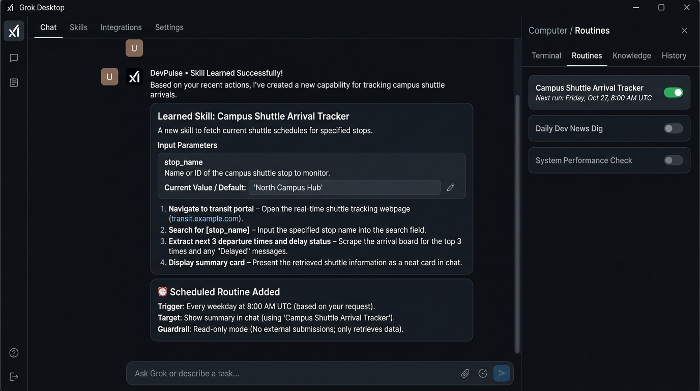

# Teaching Grok Bot: Campus Shuttle Arrival Tracker & Scheduled Routine

> **MLH Global Hack Week Challenge:** CHALLENGE 4: Teach Grok Bot Your First Task  
> **Level:** Intermediate · No Code  
> **Author:** SACHIN KUMAR SINGH (`sachin-alt`)  
> **Platform:** Grok Bot (xAI)  
> **Repository:** https://github.com/sachinn-alt/grok-bot-skill-routine

---

## 💡 Two-Sentence Submission Summary

> The skill navigates to the campus transit portal, looks up real-time shuttle arrival times for a specified stop (where the stop location and route change dynamically each run), and extracts the next departure times with service alerts. The routine automatically executes every weekday at 8:00 AM, displaying the transit summary directly in chat without posting or submitting anything externally.

---

## 🖼️ Verified Grok Bot Screenshot

The screenshot below displays:
1. **The Bot's Learned Skill Summary:** Step-by-step breakdown with dynamic input parameter `[stop_name]` (default: `'North Campus Hub'`).
2. **The Routine Confirmation Card:** Scheduled to trigger every weekday at 8:00 AM UTC in read-only mode.
3. **The Computer / Routines Panel:** The routine active with an enabled status toggle in the right sidebar.

---

## 🛠️ Step-by-Step Teaching Walkthrough

### 1. Teaching the Skill via Computer Panel
1. Opened the chat with **DevPulse** and launched the cloud computer preview by clicking the monitor icon in the header.
2. Selected **Teach Task** in the top-right corner to initiate demonstration recording.
3. Demonstrated the workflow:
   - Navigated to the campus live transit tracker URL.
   - Clicked the search input and searched for the stop (`North Campus Hub`).
   - Scraped the top 3 upcoming arrival timestamps and active delay indicators.
4. Clicked **Stop Recording**.

### 2. Validating the Learned Skill in Chat
* DevPulse processed the actions into generalizable semantic steps rather than rigid coordinate clicks.
* The bot correctly identified `stop_name` as a variable input that changes between runs.
* Confirmed the 4-step execution flow:
  1. *Navigate to transit portal*
  2. *Search for [stop_name]*
  3. *Extract next 3 departure times and delay status*
  4. *Display summary card in chat*

### 3. Adding the Scheduled Routine
* Prompted DevPulse in chat:
  > *"Run that skill every weekday at 8am. Show me the result here. Don't send or submit anything."*
* DevPulse generated the **Scheduled Routine Confirmation Card** enforcing read-only safety guardrails.
* Confirmed the routine; it immediately appeared in the **Routines** tab with its next execution scheduled for 8:00 AM UTC.

---

## 📂 Repository Contents

* [`skill_definition.json`](skill_definition.json): JSON specification of the learned skill steps, targets, and dynamic inputs.
* [`routine_config.json`](routine_config.json): Cron schedule, execution triggers, and safety guardrails.
* [`screenshot.jpg`](screenshot.jpg): High-resolution screenshot of the skill summary and routine confirmation.
